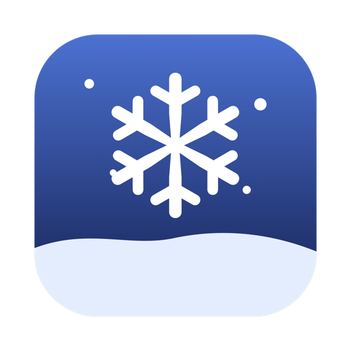
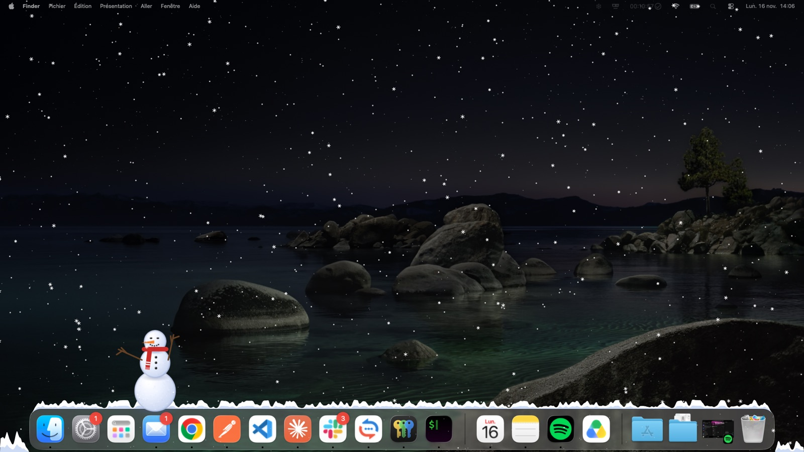
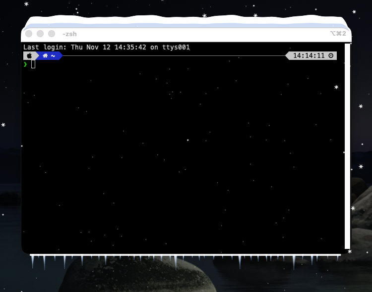
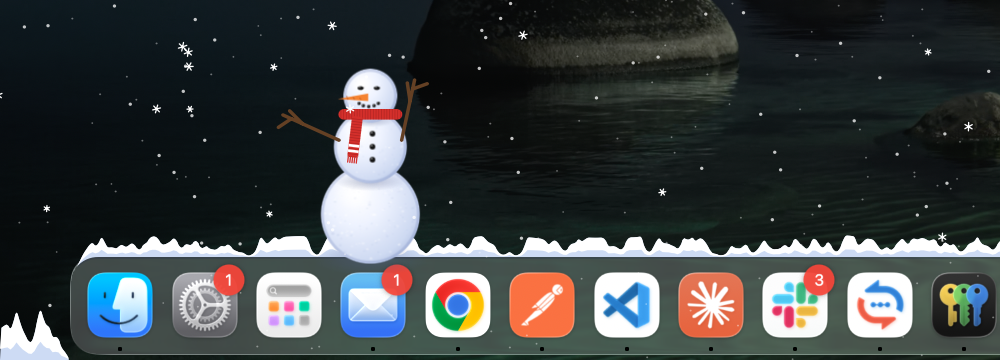
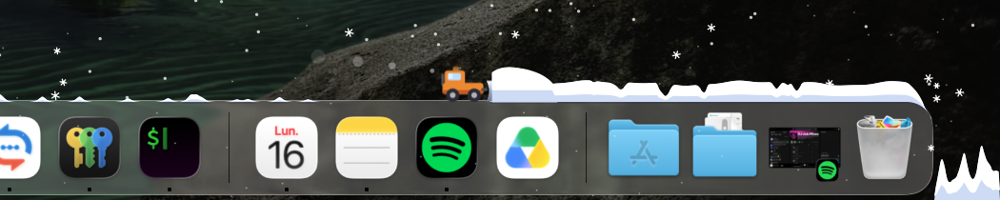

<p align="center">
  
</p>

<h1 align="center">Flocon</h1>

<p align="center">
  <strong>Il neige sur ton Mac.</strong><br>
  La neige tombe sur ton bureau, se pose sur tes fenêtres, ton Dock et tes dossiers,<br>
  et un bonhomme de neige vient parfois te dire bonjour.
</p>

<p align="center">
  
  
  
</p>

<p align="center">
  <a href="#installer"><strong>Installer Flocon</strong></a>
  &nbsp;·&nbsp;
  <a href="#ce-qui-se-passe-sur-ton-bureau">Voir ce qu'il fait</a>
  &nbsp;·&nbsp;
  <a href="#le-menu-">Le menu</a>
</p>

<p align="center">
  
</p>

---

## Ce qui se passe sur ton bureau

- **La neige tient.** Elle s'accumule sur le haut des fenêtres, sur le Dock, sur les icônes du bureau et sur les widgets, en suivant leurs coins arrondis.
- **Elle tombe en mottes.** Bouge ou ferme une fenêtre enneigée : sa neige se détache, dégringole et se pose sur ce qu'elle rencontre en dessous, une autre fenêtre, une icône ou le Dock.
- **Tu peux la pousser à la souris.** Garde le bouton enfoncé et traverse la neige : lentement elle s'émiette, de côté elle s'entasse devant le pointeur, d'un coup sec elle s'envole. Glisser une fenêtre ou une icône marche comme avant.
- **Un chasse-neige passe sur le Dock** de temps en temps, gyrophare allumé. Il pousse une congère devant sa lame et la fait tomber au bout. Le bonhomme sur son chemin se fait renverser.
- **Des stalactites poussent** sous les fenêtres qu'on laisse tranquilles.
- **Un bonhomme de neige** se construit de temps en temps sur le Dock. Il cligne des yeux, regarde autour de lui, salue, sautille, lance des boules de neige, puis fond.
- **Tu peux le démolir.** Chaque clic fait éclater une boule : celle du bas le fait descendre d'un étage, celle du milieu fait rouler sa tête dans la neige.
- **Il sait se faire oublier.** Dès qu'un écran passe en plein écran, Flocon se met en veille sur tous les écrans et ne calcule plus rien. Les clics traversent la neige, sauf sur le bonhomme : rien ne gêne ton travail.

<p align="center">
  
</p>

<p align="center">
  
</p>

<p align="center">
  
</p>

## Installer

Il faut macOS 14 ou plus récent et les outils de ligne de commande d'Xcode (`xcode-select --install`).

```bash
git clone https://github.com/AkCoooo/flocon.git
cd flocon
./build-app.sh
```

Le script compile, emballe `Flocon.app` avec son icône, la signe et l'installe dans `~/Applications`. Ouvre-la : un flocon ❄︎ apparaît dans la barre des menus, et il commence à neiger.

> [!TIP]
> Pour garder l'autorisation Accessibilité d'une version à l'autre, crée une fois un certificat de signature de code nommé `Flocon Dev` (Trousseaux d'accès › Assistant de certification › Créer un certificat, type « Signature de code », puis « Toujours approuver »). Sans lui, la signature change à chaque build et macOS redemande l'autorisation.

## Autorisation

La neige sur le Dock et les icônes du bureau passe par l'API d'Accessibilité : Flocon demande où ils se trouvent pour savoir où poser la neige. Le menu propose **Autoriser la neige sur le Dock…** tant que l'accès n'est pas donné. Sans l'autorisation, il neige quand même sur les fenêtres et les widgets.

## Le menu ❄︎

| Entrée | Ce qu'elle fait |
|---|---|
| **Faire neiger** | Lance ou arrête la neige |
| **Quantité** | Légère, Normale ou Tempête |
| **Bonhomme de neige** | L'afficher, le laisser lancer des boules de neige, ou en construire un tout de suite |
| **Réglages** | Neige qui tient vite, chasse-neige sur le Dock (ou le faire passer tout de suite), ouvrir au démarrage du Mac |

## Sous le capot

| Fichier | Rôle |
|---|---|
| `AppDelegate.swift` | Une vitre transparente par écran, et le menu ❄︎ |
| `SnowView.swift` | Le moteur : chute, atterrissage, tas, mottes, dessin |
| `Pile.swift` | Un tas de neige en colonnes, qui suit les coins arrondis |
| `WindowTracker.swift` | Où sont les fenêtres et les widgets |
| `DockLocator.swift`, `DesktopIcons.swift` | Ce que l'Accessibilité dit du Dock et du bureau |
| `Icicles.swift` | Les stalactites |
| `Clump.swift` | Les mottes qui tombent quand une fenêtre bouge |
| `Snowman.swift` | Le bonhomme de neige |
| `Snowplow.swift` | Le chasse-neige du Dock |
